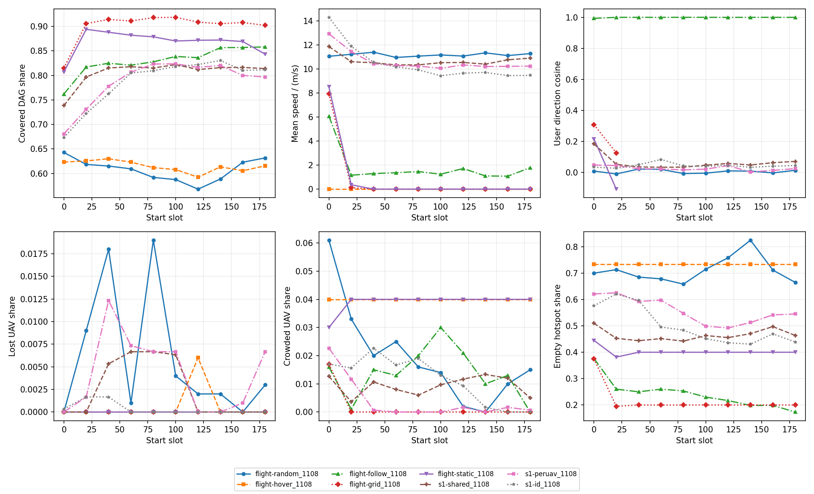

# 飞行规则与 S1 时间段对比

日期：2026-11-08  
服务器：`10.12.54.24:/data2/zrj2025/HyperUAV-zdq`  
状态：完成；未训练新模型；未 commit。

## 1. 口径

- 评估集固定为 `seed=1, episode=0–9`，放置统一使用 HEFT 式。
- 每 20 个时隙一段，共十段。多个 episode 先累计分子、分母，再计算比例。
- S1 使用三个最终 checkpoint（训练种子 10、11、12），表中 `±` 为三个种子的总体标准差。
- “时隙 100–199 覆盖”是后五个 20 时隙分段覆盖率的算术平均。
- 飞行规则结果来自各自 `summary.json` 的十个 episode 汇总；S1 结果来自重放汇总。

来源编号：

| 编号 | 服务器文件 |
|---|---|
| B-random | `output/runs/flight-random_1108/summary.json` |
| B-hover | `output/runs/flight-hover_1108/summary.json` |
| B-follow | `output/runs/flight-follow_1108/summary.json` |
| B-grid | `output/runs/flight-grid_1108/summary.json` |
| B-static | `output/runs/flight-static_1108/summary.json` |
| R-shared | `output/checks/replay/s1-shared_1108/summary.json` |
| R-peruav | `output/checks/replay/s1-peruav_1108/summary.json` |
| R-id | `output/checks/replay/s1-id_1108/summary.json` |

## 2. 主结果

比例列单位为百分比；平均速度是每架 UAV 每时隙的实际水平位移除以时隙长度。

| 方法（来源） | 平均时延/s | 按时完成率/% | 被覆盖 DAG/% | 覆盖内按时/% | 平均速度/(m/s) | 走丢/% | 挤热点/% | 空热点/% | 时隙 100–199 覆盖/% |
|---|---:|---:|---:|---:|---:|---:|---:|---:|---:|
| HEFT+random [B-random] | 0.6833 | 86.3261 | 60.7604 | 99.4686 | 11.1732 | 0.5800 | 1.9600 | 71.1000 | 59.9770 |
| HEFT+hover [B-hover] | 0.6788 | 86.5120 | 61.4810 | 99.3572 | 0.0000 | 0.0600 | 4.0000 | 73.3333 | 60.6967 |
| HEFT+follow [B-follow] | 0.6294 | 93.3309 | 82.9734 | 98.9945 | 1.8299 | 0.0000 | 1.3900 | 24.1667 | 84.9223 |
| HEFT+grid [B-grid] | 0.6458 | 94.8497 | 90.0429 | 98.2129 | 0.8069 | 0.0000 | 0.1700 | 21.7000 | 90.8409 |
| HEFT+static [B-static] | 0.6089 | 94.2789 | 86.7445 | 98.7464 | 0.8887 | 0.0000 | 3.9000 | 40.2667 | 86.5199 |
| S1-shared [R-shared] | 0.6291 ± 0.0048 | 92.3115 ± 0.4786 | 80.6161 ± 1.6530 | 98.7210 ± 0.1173 | 10.6852 ± 0.2596 | 0.2500 ± 0.3536 | 0.9267 ± 0.7021 | 46.5111 ± 7.7952 | 81.5951 ± 1.8683 |
| S1-peruav [R-peruav] | 0.6323 ± 0.0034 | 91.8199 ± 0.3512 | 78.7487 ± 0.9480 | 98.7447 ± 0.1531 | 10.6440 ± 0.3896 | 0.4233 ± 0.4125 | 0.3900 ± 0.1980 | 55.7500 ± 3.8104 | 81.1326 ± 1.2851 |
| S1-id [R-id] | 0.6258 ± 0.0053 | 91.7407 ± 0.7433 | 78.6342 ± 2.0033 | 98.7061 ± 0.1657 | 10.4619 ± 0.5228 | 0.0367 ± 0.0450 | 1.1500 ± 0.2449 | 50.0056 ± 7.6020 | 81.8401 ± 2.5112 |

结果比较：

1. `grid` 的覆盖率和按时完成率最高，十个 episode 汇总分别为 90.04% 和 94.85%；到点后几乎不再移动。
2. `static` 的平均时延最低，为 0.6089 s。它按初始 UE 的到达权重选点，覆盖率低于 `grid`，但选到的区域更有利于时延。
3. `follow` 只使用每架 UAV 自己关联且被覆盖的 UE，平均时延 0.6294 s，与 S1-shared 的 0.6291 s 接近，按时完成率则高 1.02 个百分点。
4. 三种 S1 的后半段覆盖都稳定在约 81%–82%，但平均速度仍约 10.5 m/s；它们没有像三个目标点规则那样到点悬停。
5. `hover` 与 `random` 的覆盖和时延接近，说明初始随机部署本身约有 61% 的覆盖；持续随机飞行没有带来稳定增益。

## 3. 十段覆盖率

单元格为被覆盖 DAG 占比（%）。S1 为三个种子的均值 ± 总体标准差。

| 方法 | 0 | 20 | 40 | 60 | 80 | 100 | 120 | 140 | 160 | 180 |
|---|---:|---:|---:|---:|---:|---:|---:|---:|---:|---:|
| HEFT+random | 64.28 | 61.84 | 61.51 | 60.94 | 59.19 | 58.76 | 56.80 | 58.87 | 62.29 | 63.17 |
| HEFT+hover | 62.32 | 62.56 | 62.99 | 62.32 | 61.18 | 60.80 | 59.23 | 61.35 | 60.55 | 61.55 |
| HEFT+follow | 76.21 | 81.71 | 82.47 | 82.08 | 82.76 | 83.86 | 83.61 | 85.65 | 85.68 | 85.81 |
| HEFT+grid | 81.49 | 90.57 | 91.41 | 91.09 | 91.78 | 91.84 | 90.86 | 90.54 | 90.77 | 90.20 |
| HEFT+static | 80.70 | 89.39 | 88.79 | 88.19 | 87.86 | 87.01 | 87.16 | 87.20 | 86.90 | 84.33 |
| S1-shared | 73.85 ± 0.87 | 79.67 ± 0.59 | 81.51 ± 1.71 | 81.76 ± 2.67 | 81.50 ± 2.91 | 82.20 ± 2.34 | 81.18 ± 2.30 | 81.58 ± 2.47 | 81.62 ± 1.91 | 81.39 ± 1.08 |
| S1-peruav | 68.07 ± 0.85 | 73.10 ± 1.02 | 77.78 ± 1.92 | 80.64 ± 2.40 | 82.32 ± 1.74 | 82.34 ± 1.16 | 81.64 ± 1.19 | 82.01 ± 1.77 | 80.00 ± 1.97 | 79.67 ± 0.90 |
| S1-id | 67.32 ± 0.63 | 72.24 ± 2.03 | 76.23 ± 2.90 | 80.49 ± 2.96 | 80.95 ± 2.54 | 81.80 ± 1.83 | 82.21 ± 2.86 | 83.03 ± 2.98 | 81.03 ± 3.24 | 81.13 ± 2.36 |



服务器原图：`output/runs/flight-compare_1108/figures/segments.png`。  
报告附图：`docs/superpowers/reports/assets/2026-11-08/flight-segments.png`。

## 4. 小检查

小检查产物在 `output/checks/flight-rules/<规则>/`，每个规则均为 `(seed=1, episode=0)`，`invalid_placements` 都为 0。

- `hover`：十段平均速度全部为 0；动作恒为 0，因此方向余弦按定义没有有效样本，记为 `null`。
- `follow`：十段方向余弦依次为 0.989204、0.998869、0.999971、0.999974、0.999998、0.999930、0.999151、1.000000、1.000000、0.999211。
- `grid`：配对后的五个目标点为 `(300,300)`、`(450,450)`、`(450,150)`、`(150,450)`、`(150,150)`；到点时隙为 8、1、9、12、7；到点后最大速度全部为 0。
- `static`：配对后的五个目标点为 `(350,160)`、`(420,470)`、`(500,160)`、`(230,440)`、`(50,170)`；到点时隙为 10、1、6、7、8；到点后最大速度全部为 0。五点对第 0 时隙 UE 的到达权重覆盖占比为 96.2963%。

## 5. 随机规则复现核对

指定参考文件 `output/runs/baselines_1106/summary.json` 在本次运行前已经不存在，因此不能对该路径做逐字段比较。

仍保留的 `output/runs/baselines_1108/summary.json` 来自同一评估集。新 `flight-random_1108` 与它的 HEFT 结果在 25 个原有字段上完全相同，没有任何差异：

- 按时完成率：0.8632606674243207（86.3261%）；
- 平均时延：0.6832516237998728 s；
- `invalid_placements`：0。

这也与需求文档给出的 86.33% / 0.683 s 一致。

## 6. 改动

只修改了指定的五个代码文件；需求文档的未提交改动是用户已有改动。

| 文件 | 增加 | 删除 | 职责 |
|---|---:|---:|---|
| `methods_v2/baselines/policies.py` | 77 | 0 | 四个飞行规则、目标配对和静态覆盖选点 |
| `experiments_v2/runs/baselines.py` | 97 | 19 | 选择放置/飞行规则、记录分段统计与目标诊断 |
| `experiments_v2/runs/metrics.py` | 91 | 0 | 共用 `FlightStats` 和唯一的 `direction_cosines` |
| `experiments_v2/checks/replay.py` | 155 | 110 | 重放十个评估 episode，按来源实验写目录并汇总分段统计 |
| `experiments_v2/runs/plot.py` | 80 | 18 | 读取基线和重放汇总，绘制 2×3 分段对比图 |
| `docs/superpowers/reports/2026-11-08-flight.md` | 178 | 0 | 本报告 |
| `docs/superpowers/reports/assets/2026-11-08/flight-segments.png` | 新增二进制 | 0 | 报告附图 |

没有修改 `environment_v2/`、`methods_v2/learning/` 或 `methods_v2/mappo/`。

## 7. 命令与用时

开跑前 `df -h /data2`：总计 7.3 T，已用 6.8 T，可用 131 G，使用率 99%。

小检查命令（`<规则>` 依次为 random、hover、follow、grid、static）：

```bash
python experiments_v2/runs/baselines.py --name flight-check-<规则> --policies heft --flight <规则> --pair 1 0
```

| 规则 | 用时/s |
|---|---:|
| random | 6.63 |
| hover | 5.92 |
| follow | 7.95 |
| grid | 9.84 |
| static | 6.63 |

正式基线命令：

```bash
python experiments_v2/runs/baselines.py --name flight-<规则>_1108 --policies heft --flight <规则>
```

| 规则 | 用时/s |
|---|---:|
| random | 59.12 |
| hover | 55.35 |
| follow | 75.58 |
| grid | 95.47 |
| static | 73.97 |

五个正式基线并行执行，实际墙钟由最慢的 grid 决定，为 95.47 s。

重放命令一次传入以下九个 checkpoint，耗时 777.65 s：

```bash
python experiments_v2/checks/replay.py --checkpoint \
  output/runs/s1-shared_1108/seed10/checkpoints/checkpoint_0100.pt \
  output/runs/s1-shared_1108/seed11/checkpoints/checkpoint_0100.pt \
  output/runs/s1-shared_1108/seed12/checkpoints/checkpoint_0100.pt \
  output/runs/s1-peruav_1108/seed10/checkpoints/checkpoint_0100.pt \
  output/runs/s1-peruav_1108/seed11/checkpoints/checkpoint_0100.pt \
  output/runs/s1-peruav_1108/seed12/checkpoints/checkpoint_0100.pt \
  output/runs/s1-id_1108/seed10/checkpoints/checkpoint_0100.pt \
  output/runs/s1-id_1108/seed11/checkpoints/checkpoint_0100.pt \
  output/runs/s1-id_1108/seed12/checkpoints/checkpoint_0100.pt
```

每个 S1 实验均得到 3 个 checkpoint 汇总、6,000 条逐时隙记录、10 段统计和一张 seed10 轨迹图。

绘图命令耗时 0.99 s：

```bash
python experiments_v2/runs/plot.py --segments \
  output/runs/flight-random_1108/summary.json \
  output/runs/flight-hover_1108/summary.json \
  output/runs/flight-follow_1108/summary.json \
  output/runs/flight-grid_1108/summary.json \
  output/runs/flight-static_1108/summary.json \
  output/checks/replay/s1-shared_1108/summary.json \
  output/checks/replay/s1-peruav_1108/summary.json \
  output/checks/replay/s1-id_1108/summary.json \
  --output output/runs/flight-compare_1108/figures
```

原始日志：

- 正式基线：`output/runs/flight-<规则>_1108/run.log`；
- 重放：`output/checks/replay/run.log`；
- 绘图：`output/runs/flight-compare_1108/plot.log`。
