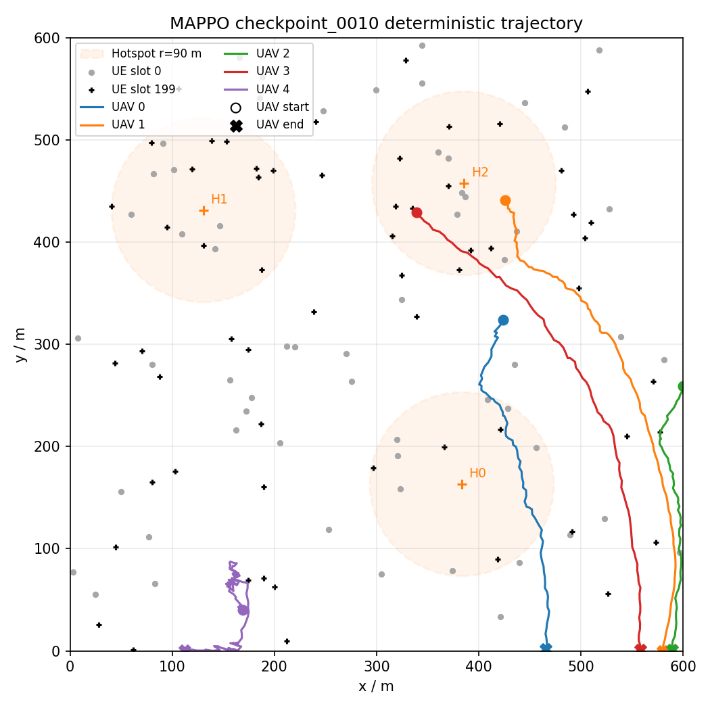
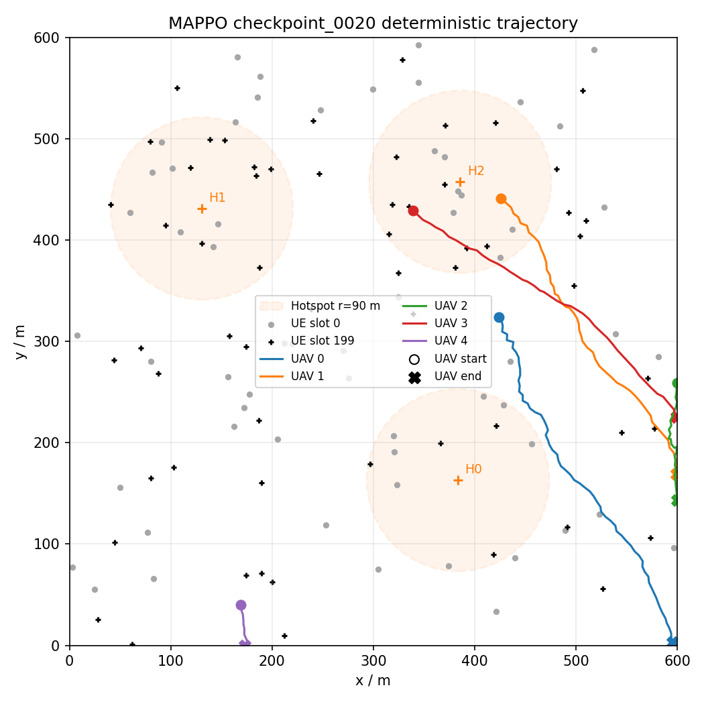
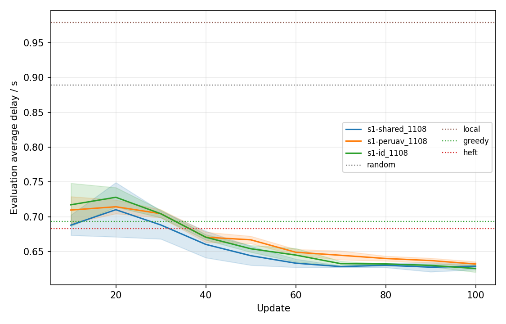
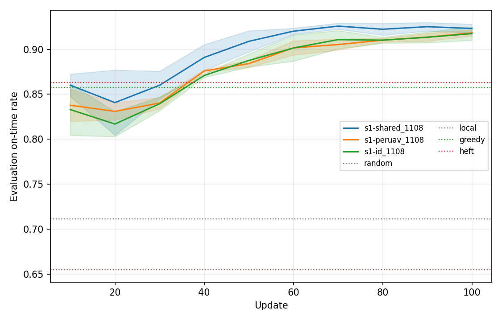
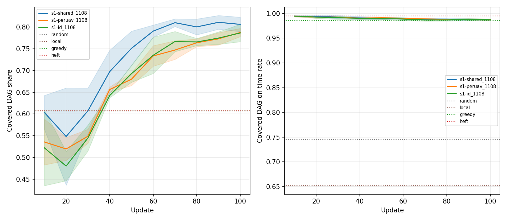
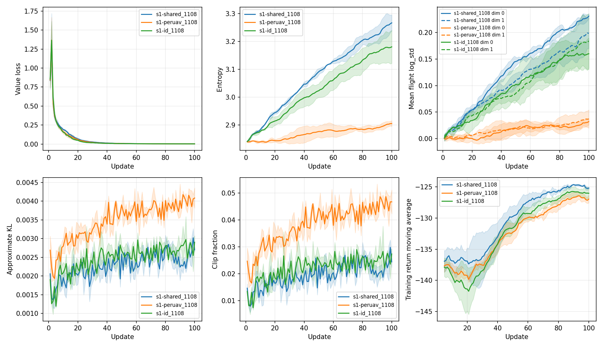
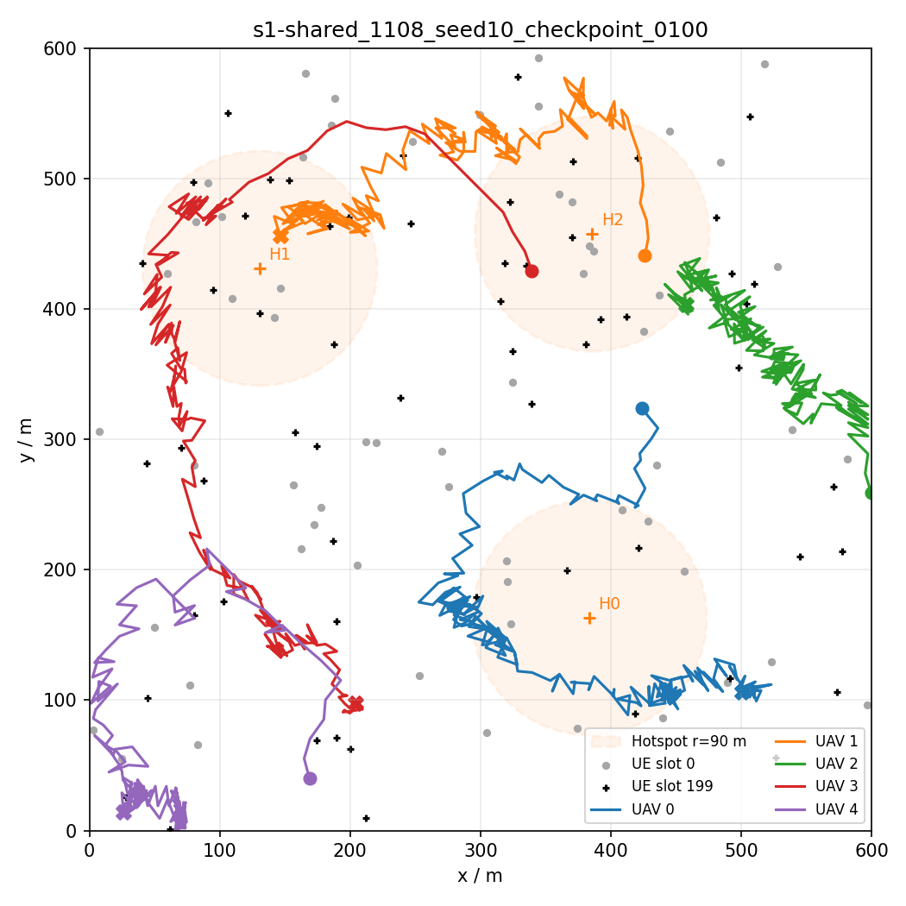
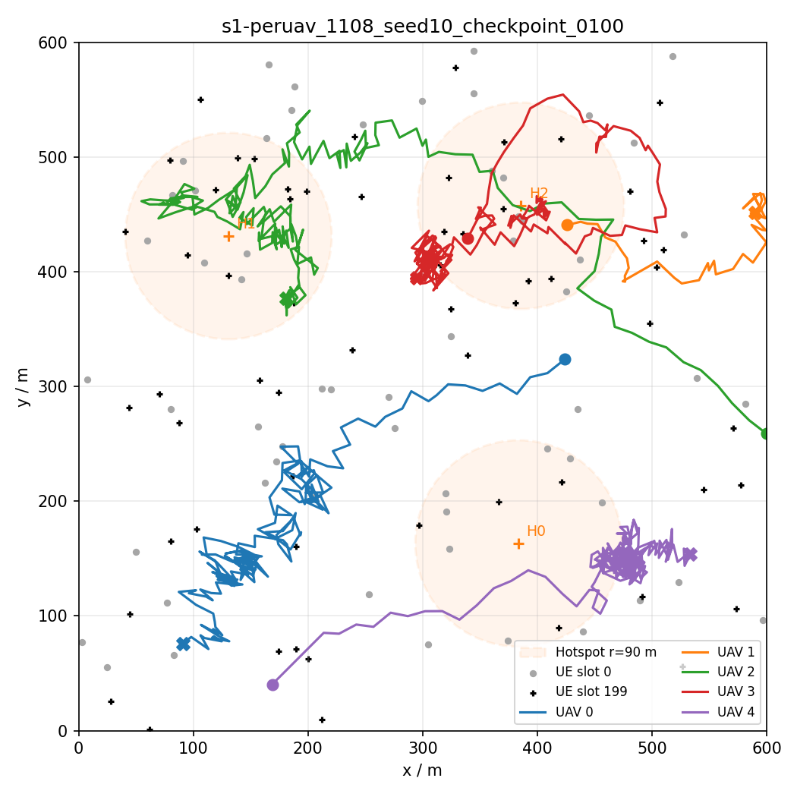
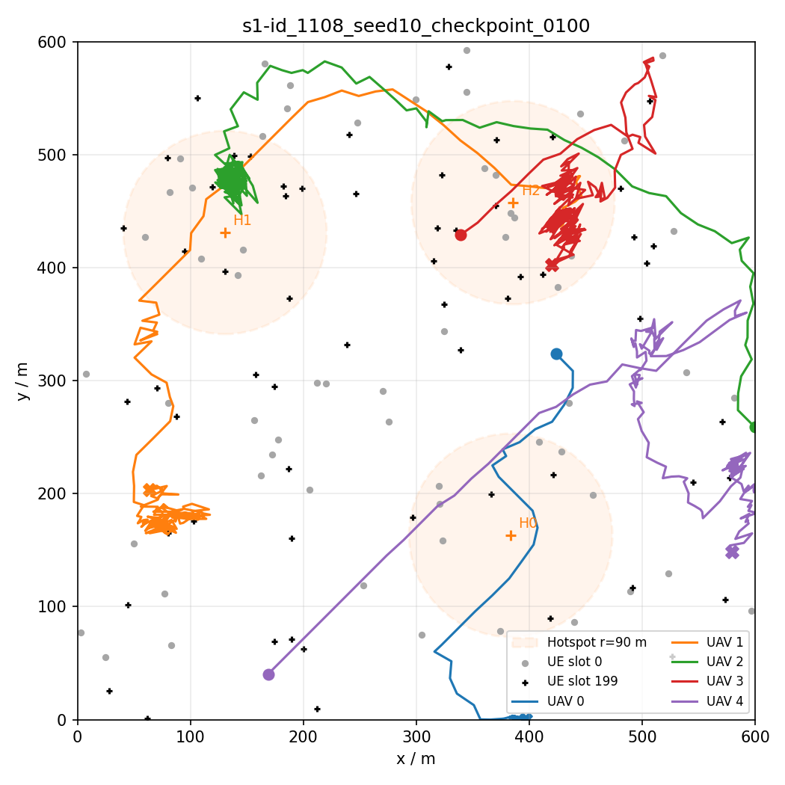

# MLP 版 MAPPO 初步实验报告（2026-11-08）

> 按师兄意见：总带宽适当提高；先不接超图，用 MLP 把强化学习跑通；奖励先只看时延。
> 本报告记录两轮实验：第一轮飞行和放置一起学（joint_1106），第二轮放置固定、只学飞行（S1）。
> 数字后面括号里注明来源：日志 = 训练或重放输出的 metrics / summary；代码 = 仓库里的实现；估算 = 我按已有数据手算。
> 图片放在 `assets/2026-11-08/` 下，原图在服务器 `/data2/zrj2025/HyperUAV-zdq/output/`。

## 0. 结论

1. 整套流程已跑通：采样、奖励、PPO 更新、critic 学习、固定评估集评估都正常，非法分配始终为 0（日志）。
2. 第一轮飞行和放置共用一个网络一起学：放置在学（覆盖内按时完成率 75% → 90%），但飞行没学到东西，5 架 UAV 一起往同一个方向漂、贴边，覆盖从约 60% 掉到约 34%，总按时完成率只有 72%，和随机基线差不多（日志）。
3. 第二轮把飞行单独拿出来学、放置固定用 HEFT 式：3 种参数共享方式 × 3 个种子全部明显好于“HEFT 式 + 随机飞行”。覆盖 60.8% → 约 80%，平均时延 0.683 s → 约 0.63 s（−8%），按时完成率 86.3% → 约 92%（日志）。
4. 三种共享方式（共用一个网络 / 每架一个网络 / 共用网络加编号）结果打平，保留最简单、可换 UAV 数量的“共用一个网络”。
5. 学出来的飞行是“飞到人多的地方然后停住”；但每回合仍有 1–3 架走丢或贴边，多架挤同一热点。还没和简单飞行规则比，暂不能说学出来的飞行比规则好。

## 1. 实验设置

### 1.1 环境（当前默认值）

| 项 | 取值 |
|---|---|
| 地图 | 600 m × 600 m |
| 热点 | 3 个，半径 90 m；每个 episode 重新随机抽中心，episode 内不动 |
| UAV | 5 架，高度 100 m，5 GHz，每时隙每个方向最多飞 15 m，空对空通信距离 300 m |
| UE | 60 个，1 GHz；初始每个热点 7 个、热点外 39 个（35% / 65%，代码）；随机走，热点内速度减半（第 199 时隙热点内约 4 / 10 / 10 个，日志） |
| 到达 | 每个 UE 每时隙一次伯努利，p = 0.24，热点内 × 2；每时隙约 19.5 个 DAG，约 52% 来自热点（估算） |
| 带宽 | 20 MHz（原 12 MHz，按师兄意见提高） |
| 时隙 / 截止 | 1 s / 1 s；每个 episode 200 个时隙 |
| 覆盖外 | 不在任何 UAV 覆盖内的 UE，整个 DAG 在本地算 |
| 越界 | 照 MRDTS：飞行动作任一分量出界，这一步不移动 |

### 1.2 算法

- MAPPO（Yu 等，NeurIPS 2022），按官方代码 on-policy（commit `de66d7a`）实现：集中训练、分布式执行；5 架 UAV 共用 actor 参数；critic 输入全局状态，每个时隙一个价值。
- 官方的关键部件都保留：ValueNorm（回报滑动归一化）、Huber 损失、value 裁剪、优势归一化、输出层小初始化、输入 LayerNorm、不可选动作屏蔽。
- 超参全部用官方默认：

| 项 | 值 |
|---|---|
| 学习率（actor、critic） | 5e-4 |
| 每次更新的轮数 / 小批数 / 裁剪 | 15 / 1 / 0.2 |
| 熵系数 / 价值损失系数 / 梯度上限 | 0.01 / 1 / 10 |
| γ / GAE λ | 0.99 / 0.95 |
| 网络 | 两层 64、ReLU |
| 每次更新的数据 | 32 个完整 episode（6400 个时隙），32 个进程并行采样 |

### 1.3 动作与观测

- 飞行：每架 UAV 一个 2 维连续动作（高斯分布），取值 [−1, 1]，乘以 15 m 为本时隙位移。
- 放置（只在第一轮学）：UAV 管理的每个子任务，在“该 DAG 的 UE、自己、邻居 UAV”里选一个执行节点，不可选的屏蔽掉。进队顺序由 ERS（师兄 MRDTS 的 HEFT 式排序）给出。
- 局部观测（32 维）：自己的位置；其余 4 架是否邻居、相对位置、邻居本时隙要管的子任务数和计算量；自己覆盖的用户个数、相对重心、四个象限的分布；自己本时隙要管的 DAG 数、子任务数、计算量。
- 全局状态（180 维，给 critic）：5 架的局部观测拼接，加本时隙新 DAG 总数、覆盖外 DAG 数、总计算量、全部 UE 在 4 × 4 网格中的分布、剩余时隙比例。
- 特征缩放全部用固定常数（个数除以最大可能值，计算量除以对应算力等），不做运行时统计。

### 1.4 奖励（只看时延）

$$r_t = -\frac{1}{\bar N}\sum_{d\in \mathcal D_t}\frac{f_d - a_d}{D}$$

- $\mathcal D_t$：本时隙新到的全部 DAG（含覆盖外的）；$f_d - a_d$：DAG 实际时延（超时的也照样算完、计入）；$D$：截止期 1 s；$\bar N$ = 19.5，每时隙期望到达数，只起缩放作用。
- 所有 UAV 共用这一个团队奖励；不设上限、超时不另罚、越界不罚、能耗只记录不进奖励。
- 依据：只做时延的 DAG 卸载工作主流就是“负时延或负时延增量”（如 DRLTO，IEEE TC 2022；Qi 等，NeurIPS 2025）。环境每个时隙从空队列开始、当场算完新 DAG，所以奖励在本时隙就能结算。
- 核对：用贪心基线跑一个 episode，由奖励还原出的平均归一化时延 0.6746593930957117，直接计算 0.674659393095712（日志）。

### 1.5 评估方式

- 固定评估集：seed = 1，episode 0–9，确定性动作（飞行取均值，放置取概率最大）；训练种子不用 1，与评估集不重叠。
- 主指标：平均时延、按时完成率；解释指标：被覆盖 DAG 占比、覆盖内 / 覆盖外的按时完成率与时延。
- 基线（放置规则 + 随机飞行，评估集，日志）：

| 基线 | 按时完成率 | 平均时延 | 覆盖占比 | 覆盖内按时完成率 |
|---|---:|---:|---:|---:|
| 随机 | 71.13% | 0.889 s | 60.76% | 74.46% |
| 全本地 | 65.50% | 0.979 s | 60.76% | — |
| 贪心（整个 DAG 放一个节点） | 85.77% | 0.694 s | 60.76% | — |
| HEFT 式（逐子任务） | 86.33% | 0.683 s | 60.76% | 99.47% |

可以看出：随机飞行下只有约 61% 的 DAG 被覆盖；放置用 HEFT 式时覆盖内几乎全部按时，整体上不去主要卡在覆盖上。

## 2. 第一轮：飞行和放置一起学（joint_1106）

### 2.1 设置

一个 actor 网络同时出飞行动作和放置动作：两部分共用一个主干，上面接飞行头和放置打分头；PPO 比值按“飞行 + 全部子任务放置”的对数概率之和算。训练种子 0，50 次更新，共 1600 个训练 episode（日志）。每次更新约 70 s（采样 15.6 s + 更新 54.3 s，日志）。

### 2.2 结果

评估集结果（日志）：

| 更新次数 | 按时完成率 | 平均时延 | 覆盖占比 |
|---:|---:|---:|---:|
| 10 | 71.43% | 0.874 s | 50.20% |
| 20 | 70.41% | 0.892 s | 36.57% |
| 30 | 72.03% | 0.864 s | 37.42% |
| 40 | 71.92% | 0.869 s | 32.27% |
| 50 | 72.07% | 0.866 s | 33.64% |
| 随机基线 | 71.13% | 0.889 s | 60.76% |

训练过程（每次更新的训练 episode 平均，日志）：

| 更新次数 | 训练回报 | 覆盖占比 | value loss | 熵 | 近似 KL | 裁剪比例 |
|---:|---:|---:|---:|---:|---:|---:|
| 1 | −177.8 | 60.1% | 0.860 | 23.3 | 0.0023 | 1.7% |
| 10 | −177.1 | 53.4% | 0.173 | 21.1 | 0.0024 | 2.1% |
| 20 | −177.2 | 43.6% | 0.038 | 17.7 | 0.0037 | 4.1% |
| 30 | −176.6 | 36.5% | 0.016 | 15.8 | 0.0043 | 4.8% |
| 40 | −172.8 | 37.7% | 0.010 | 15.5 | 0.0044 | 5.3% |
| 50 | −176.0 | 33.1% | 0.0055 | 13.9 | 0.0046 | 5.6% |

- critic 学得很好（value loss 0.86 → 0.0055），KL 和裁剪比例都在正常范围。
- 训练回报几乎不动，但不是“什么都没学到”：覆盖一路下降，同时放置在变好，两者互相抵消。
- 熵下降主要因为覆盖少了、要放置的子任务少了（熵按子任务相加）。

### 2.3 诊断：重放第 1、10、20、50 次的 checkpoint

评估回合（seed 1、episode 0，确定性动作）的统计（日志）：

| checkpoint | 飞行均值（5 架、200 时隙平均） | 越界不动的时隙 | 离边界 < 30 m | 覆盖占比（前 / 后 50 时隙） | 覆盖内按时完成率 / 时延 |
|---|---|---:|---:|---|---|
| 1 | (−0.005, 0.011) | 19.2% | 24.5% | 49.0% / 53.2% | 75.2% / 0.81 s |
| 10 | (0.014, −0.268) | 48.8% | 66.1% | 49.0% / 14.9% | 83.8% / 0.65 s |
| 20 | (0.201, −0.340) | 80.0% | 86.2% | 29.6% / 14.3% | 74.2% / 0.82 s |
| 50 | (0.718, −0.546) | 93.5% | 94.8% | 17.8% / 13.7% | 90.1% / 0.55 s |

每架 UAV 的平均飞行均值（评估回合，日志）：

| checkpoint | UAV 0 | UAV 1 | UAV 2 | UAV 3 | UAV 4 |
|---|---|---|---|---|---|
| 10 | (0.03, −0.31) | (0.02, −0.30) | (−0.05, −0.33) | (0.05, −0.35) | (0.02, −0.05) |
| 20 | (0.11, −0.31) | (0.27, −0.40) | (0.22, −0.39) | (0.38, −0.39) | (0.02, −0.21) |
| 50 | (0.54, −0.68) | (0.88, −0.53) | (0.80, −0.62) | (0.87, −0.65) | (0.50, −0.26) |

（第 50 次的轨迹图在整理目录时被覆盖，情况见上面两张表：5 架均值都在 (0.5–0.9, −0.3 至 −0.7)，93.5% 的时隙越界不动。）

观察：

1. 5 架 UAV 的飞行输出几乎一样，和各自所处的位置无关：第 10 次一起往下，第 20 次一起往右下，第 50 次一起往右下且幅度更大。第 50 次 1000 个“UAV × 时隙”上飞行均值的标准差只有 (0.18, 0.19)（日志），基本是一个常数。
2. 例子：第 50 次时，UAV 3 起点就在热点里、身边有 7 个用户，网络仍让它以约 11 m/s 往右下离开（日志）。
3. 还有反向的依赖：飞行 x 分量与 UAV x 坐标的相关系数 +0.61，y 分量与 y 坐标 −0.50（日志），即越靠右越往右推、越靠下越往下推，把 UAV 往角落里赶。
4. 越界规则让边缘很“黏”：UAV 2 起点离右边界 0.27 m，只要 x 分量向右，整步作废；第 1 次（几乎没训练）就卡了 170 / 200 个时隙，第 50 次 200 / 200 个时隙一步没动（日志、代码）。
5. 飞行 log_std 从 0 涨到约 0.2（日志）：飞行越来越随机，说明熵奖励的推力比奖励的拉力还大，奖励几乎没作用到飞行上。

### 2.4 原因分析

| 原因 | 依据 |
|---|---|
| 放置当场见效，飞行要到后面时隙才影响覆盖，而且影响小（第 1 次时，被覆盖的 DAG 只比覆盖外快约 0.18 s：0.81 s 对 0.99 s） | 日志 |
| 飞行和约 15 个子任务的放置共用一个主干、算在同一个 PPO 比值里，飞行的信号被放置盖住 | 代码 |
| 团队奖励 5 架共享，每架飞行的贡献混在一起 | 代码 |
| 信号弱时，最容易学出的是与观测无关的常数部分，所以学成“一个固定方向”；5 架共用网络，于是一起漂 | 日志（输出几乎常数） |
| 描述“用户在哪个方向”的特征数值太小（人数除以 60 后约 0.03–0.1） | 代码 |
| 价值主要随剩余时隙变化，critic 可能把“靠角落”和“回合后期价值高”混在一起，形成往角落的正反馈 | 推断，未验证 |

参考：师兄 MRDTS（`codex/development` 分支，PPO Delay 设计文档 2026-09-08）把飞行（Master）和调度（Member）做成两个 actor、两个 critic，分阶段训练，奖励只用时延、不加越界惩罚。第二轮按这个思路把飞行单独拿出来。

## 3. 第二轮 S1：放置固定 HEFT 式，只学飞行

### 3.1 改动

- 放置每个时隙直接用 HEFT 式，不学。
- 飞行单独一个网络（不再和放置共用主干）；PPO 的对数概率、比值、熵只算飞行。
- 特征调整：四个象限改为“占自己覆盖用户的比例”；用户相对重心改为除以 300 m（空对空通信距离）。
- 奖励、critic、超参、评估集不变；越界规则不变、不罚。
- 比较三种参数共享方式：

| 方案 | 做法 |
|---|---|
| shared | 5 架共用一个飞行网络，各自输入自己的观测 |
| per_uav | 每架一个飞行网络，只用自己的经验训练（数据只有 1/5） |
| shared_id | 共用一个网络，观测末尾加 5 维 UAV 编号（官方 on-policy 在 SMAC 环境默认这样做） |

- 每个方案 3 个训练种子（10、11、12），各 100 次更新、3200 个训练 episode。9 次训练平均每次约 31 min，服务器上 3 个并发、有效墙钟约 1 h 53 min（日志）。

### 3.2 结果

最后一次（第 100 次更新）评估，3 个种子的均值 ± 标准差（日志）：

| 方案 | 覆盖占比 | 平均时延 | 按时完成率 | 覆盖内按时完成率 |
|---|---:|---:|---:|---:|
| S1 shared | 80.62% ± 1.65 | 0.629 ± 0.005 s | 92.31% ± 0.48 | 98.72% ± 0.12 |
| S1 per_uav | 78.75% ± 0.95 | 0.632 ± 0.003 s | 91.82% ± 0.35 | 98.74% ± 0.15 |
| S1 shared_id | 78.63% ± 2.00 | 0.626 ± 0.005 s | 91.74% ± 0.74 | 98.71% ± 0.17 |
| HEFT 式 + 随机飞行 | 60.76% | 0.683 s | 86.33% | 99.47% |
| 第一轮 joint_1106（第 50 次） | 33.64% | 0.866 s | 72.07% | — |

- 三个方案都明显好于 HEFT 式 + 随机飞行：覆盖 +18 至 +20 个百分点，平均时延 −7.5% 至 −8.4%，按时完成率 +5.4 至 +6.0 个百分点。3 个种子结果一致。
- 提升几乎全部来自覆盖：按覆盖 80.6%、覆盖内 98.7%、覆盖外约 65% 估算，整体约 0.806 × 98.7% + 0.194 × 65% ≈ 92.2%，与实测 92.3% 一致（估算）。
- 覆盖内按时完成率从 99.5% 略降到 98.7%：覆盖多了，UAV 负载随之上升，固定的 HEFT 放置开始吃力。这正是下一步把放置也交给网络学的理由。
- 注意：S1 相对第一轮同时改了好几处（放置换成 HEFT、飞行单独一个网络、特征调整、训练更久），不能把提升全部归因于“把飞行拆出来”。下一步 S2 让放置重新由网络学、但仍和飞行分开，能回答这个问题。

训练曲线的趋势：（待补。逐次评估的原始数据在服务器上，核对后补上：覆盖和时延从第几次更新开始改善、第 100 次时是否已经平稳。）

### 3.3 三种共享方式的比较

| | shared | per_uav | shared_id |
|---|---:|---:|---:|
| 飞行 log_std（第 100 次，x / y） | 0.231 / 0.199 | 0.032 / 0.037 | 0.160 / 0.184 |
| 5 架飞行均值的差异（越大越不一样） | 0.149 | 0.246 | 0.283 |
| 飞行方向与“指向自己覆盖用户重心”方向的平均余弦 | 0.080 | 0.054 | 0.069 |

（日志；log_std 先在 5 架上平均，再对 3 个种子平均。）

- 三者的差距小于种子之间的波动，指标给出的名次也互相矛盾（shared 覆盖和完成率最高，shared_id 时延最低），结论是打平。
- per_uav、shared_id 学出了更多分工，但没有换来更好的结果；UAV 能力相同、观测本来就不同，靠观测区分已经够用。
- 保留 shared：最简单、用上全部数据、不绑定 UAV 数量（以后扫 UAV 数、接超图都能直接用），也是 MAPPO 对同质智能体的标准做法。
- per_uav 的 log_std 几乎不涨，是因为熵奖励按 5 架平均，每个网络只分到 1/5 的推力；评估用均值动作，不影响结果。

### 3.4 轨迹（seed 10 最终 checkpoint，评估回合 seed 1、episode 0）

各架最后停在哪（从图上估读）：

| | 热点 H1 (131, 431) | 热点 H2 (386, 457) | 热点 H0 (384, 163) | 没停在热点附近的 |
|---|---|---|---|---|
| shared | UAV 1 | UAV 2（边缘） | UAV 0（外沿） | UAV 4 卡在左下角，UAV 3 停在 (205, 97) |
| per_uav | UAV 2 | UAV 3（边缘） | UAV 4（外沿） | UAV 1 贴右边界，UAV 0 在 (90, 75) |
| shared_id | UAV 2 | UAV 3 | 无 | UAV 0 贴下边界，UAV 1 在 (65, 205)，UAV 4 在 (580, 150) |

1. 三个方案学到的都是“飞到人多的地方，然后停住”；两架起点都在同一热点时，会有一架离开去另一个热点。
2. 每个方案仍有 1–3 架走丢或贴边：UAV 只看得到自己覆盖的用户和 300 m 内的邻居，离开人群后没有线索回去，也不知道远处 UAV 在管哪个热点。
3. 分工不清：例如 shared_id 两架都去了 H1，H0 没人管。
4. “停住”其实是来回抖：评估用确定性动作，锯齿来自每个时隙观测的变化（用户进出覆盖、象限比例翻转）。这也是方向余弦接近 0 的原因之一。
5. 单个回合不能比较方案优劣，以 3.2 节的评估集平均为准。

## 4. 结论

1. MAPPO 的实现和训练流程是对的：critic 正常收敛，第一轮里放置能学会，第二轮里飞行能学会。
2. 飞行和放置混在一个网络里一起学时，飞行收不到时延信号，会退化成所有 UAV 一起漂移。分开以后，只靠时延奖励就能学出“去热点、停下来”，覆盖从 61% 提到约 80%，平均时延下降约 8%。
3. 5 架 UAV 共用一个飞行网络就够了。
4. 剩下的问题是走丢、分工不清，这正好是后面超图（服务超边、覆盖超边把“谁管哪些用户、邻居在管什么”连起来）能发挥作用的地方。

## 5. 下一步

1. 先和简单飞行规则比（放置都用 HEFT 式，评估集）：不动；往自己覆盖的用户重心飞（没有覆盖用户时随机飞，只用本地信息，和 actor 拿到的信息相同）；均匀铺开后悬停；知道全部用户位置的静态部署（只作上界，自写模拟约 97% 覆盖）。如果“往重心飞”也能到 80% 左右，说明学出来的飞行目前没有优势。
2. 重放时按时间段统计：每 20 个时隙的覆盖、UAV 平均速度、方向余弦，以及“走丢 UAV 比例”“多架挤同一热点比例”，把轨迹图里看到的问题变成数字。
3. S2：放置也交给网络学，但和飞行用两个独立网络、比值分开算，照师兄的分阶段训练。
4. S3：MLP 换成超图编码；S4：扫负载、带宽，超边类型消融。
5. 动态场景（episode 内热点变化、到达率随时间变化）先记录，放到 S4 之后作鲁棒性实验。

## 6. 想请师兄确认的地方

1. 越界规则照 MRDTS（越界不动），奖励不加越界惩罚，这样是否可以？
2. 训练顺序：先只学飞行（放置固定 HEFT 式），再加入放置学习。和 MRDTS 先学调度、冻结后再学飞行的顺序相反，这样是否可以？
3. 飞行对比规则用上面四种是否够？“知道全部用户位置的静态部署”只作上界，是否合适？

## 附：数据位置（服务器 `/data2/zrj2025/HyperUAV-zdq/`）

- 第一轮训练：`output/runs/joint_1106/seed0/metrics.jsonl`；诊断与重放结果写在 `docs/superpowers/reports/2026-11-06-mlp-mappo-results.md`。
- S1：`output/runs/s1-{shared,peruav,id}_1108/seed{10,11,12}/metrics.jsonl`；对比图 `output/runs/s1-compare_1108/figures/`；轨迹与重放汇总 `output/checks/replay/`；实验记录 `docs/superpowers/reports/2026-11-08-s1.md`。
- 基线：`output/runs/baselines_1108/`。
- 方案细节：需求文档 `docs/superpowers/specs/2026-10-10-hyperuav-env-rebuild-requirements-draft.md` §0.5.10、§0.5.11。
